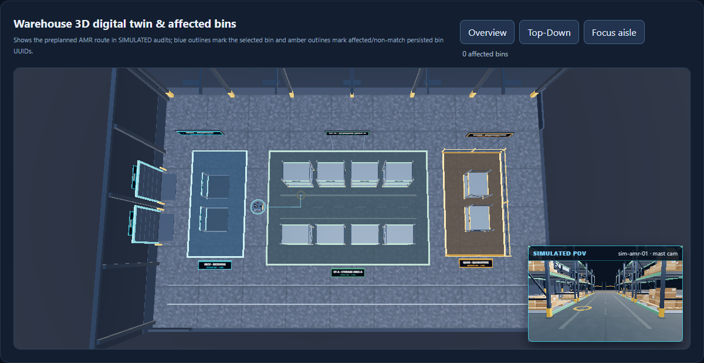
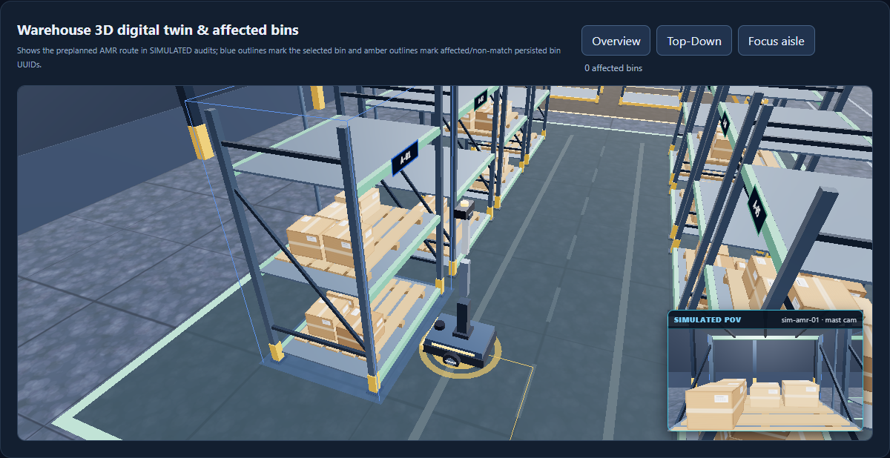
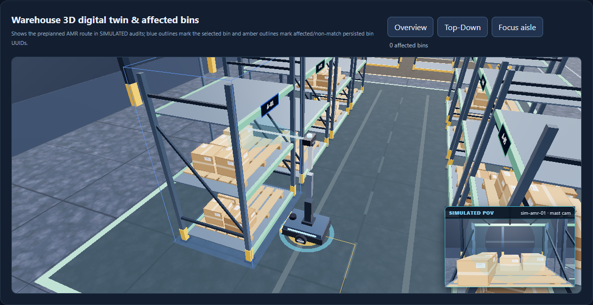
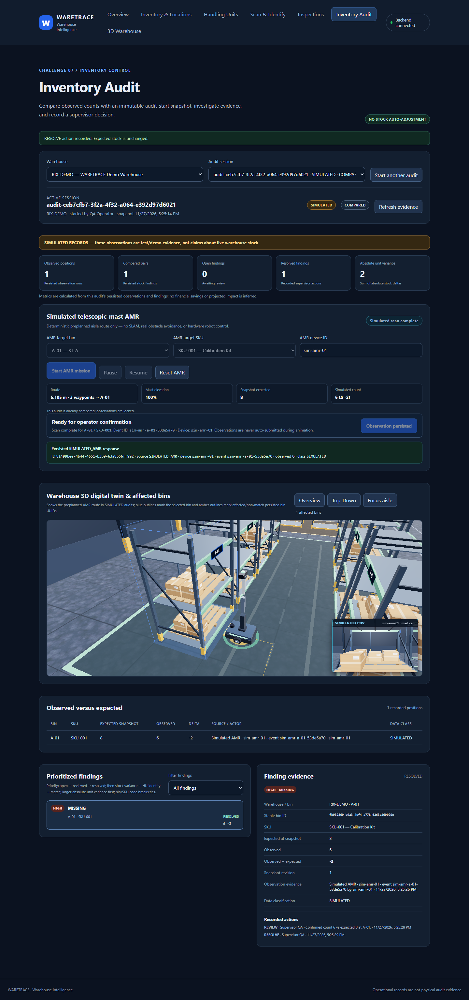

# WARETRACE CH07-AMR Final QA & Release Handoff

## 1. Repository State & Changed Files

- **Repository:** `Azizbek0770/RobotHack-WARETRACE-Prototype`
- **Branch:** `focus/challenge07-audit-intelligence` (not merged to `main`)
- **Verified base commit:** `fe2a5226c36b5a43c845fa543dd65e4200c59d1e` (`CLI implementation`)
- **QA commit:** Final QA polish, verification tests, screenshot evidence, and release handoff committed directly on top of `fe2a5226c36b5a43c845fa543dd65e4200c59d1e`.

### Changed & Added Files Since `fe2a522`

- `frontend/src/features/warehouse-3d/components/SceneCamera.tsx` — Added optional `cameraPosition` support to `CameraDirective` for unobstructed aisle framing.
- `frontend/src/features/warehouse-3d/services/amrMission.ts` — Added `computeAisleCameraFocus` and `getAmrPovInsetSize`; adjusted `stepAmrMission` delta clamping (`0.25s` max) so software WebGL renders at real-time speed without slow-motion stalling.
- `frontend/src/features/warehouse-3d/components/WarehouseAmr.tsx` — Refined AMR overview legibility, added brighter scan beam indicator, and added optional secondary Three.js mast camera inset (`AmrPovRenderer`) inside the existing WebGL context.
- `frontend/src/features/warehouse-3d/components/WarehouseScene.tsx` & `Warehouse3DViewer.tsx` — Added optional `showAmrPov` prop and framed **`SIMULATED POV`** overlay badge aligned to the secondary mast camera inset.
- `frontend/src/features/warehouse-3d/index.ts` — Exported `computeAisleCameraFocus`.
- `frontend/src/features/audit/AuditPage.tsx` — Added `Overview` / `Top-Down` / `Focus aisle` camera presets in the 3D panel, synced the session selector dropdown when transitioning `OPEN` → `COMPARED`, and added read-only server reconciliation (`listObservations`) for HTTP responses lost after backend persistence plus a **Reconcile from server** recovery action.
- `frontend/src/styles/global.css` — Added layout positioning for `.audit-3d-viewport`, `.audit-3d-canvas`, `.audit-3d-actions`, and responsive `.amr-pov-overlay`.
- `frontend/src/features/warehouse-3d/tests/amrMission.test.ts` & `frontend/src/features/audit/AuditPage.test.tsx` — Added unit tests for aisle camera focus, POV inset sizing, and lost-response server reconciliation without duplicate submission.
- `docs/integration/assets/ch07-amr-qa/*.png` & `docs/integration/CH07-AMR-FINAL-QA.md` — Captured Chromium WebGL verification screenshots and QA handoff report.

---

## 2. Automated Checks & Real Browser Verification Status

### Automated Checks (Verified After Final Code Edit)

| Suite | Command | Result |
| :--- | :--- | :--- |
| **Disposable DB Migration** | `alembic upgrade head` & `alembic check` (temp SQLite DB) | Passed (`0006_audit_observation_sources`, no pending schema changes) |
| **Backend Lint & Format** | `ruff check app tests alembic` & `black --check app tests alembic` | Passed (`80` files unchanged) |
| **Backend Tests** | `pytest -q` | **55 passed** (1 existing Starlette/httpx deprecation warning) |
| **Frontend Tests (Node `v24.19.0`)** | `npm test` (`vitest run`) | **66 passed** across 15 test files |
| **Frontend Lint & Build** | `npm run lint` (`eslint .`) & `npm run build` (`tsc -b && vite build`) | Passed (0 ESLint errors/warnings; Vite advisory on `warehouse-3d` chunk >500 kB) |
| **Standalone 3D Twin** | `npm run test`, `npm run lint`, `npm run build` in `waretrace-3d-twin/` | **19 passed** across 4 test files; `tsc --noEmit` & `vite build` passed |

### Real Browser + WebGL Verification (Chromium `1243`, SwiftShader WebGL)

Tested live against a disposable SQLite database (upgraded to `0006_audit_observation_sources` and seeded with `RIX-DEMO`) served by FastAPI (`127.0.0.1:8000`) and Vite (`localhost:5173`):

- **WebGL Scene & AMR Motion:** Confirmed AMR renders at the home staging pad (`(-8.8, 0)`), routes strictly inside the clear central aisle (`Top-Down` & `Focus aisle` views verified with zero rack/wall intersections), turns cleanly toward `A-01`, extends its 3-stage telescopic mast vertically (`0%` → `100%`), activates the cyan scan beam toward `A-01`, and renders the live **`SIMULATED POV`** mast-camera inset with zero uncaught page errors.
- **Controls & Stale-State Safety:** Verified **Start AMR mission**, **Pause** (`(Paused)` freezes state), **Resume**, **Reset AMR** (returns to `Idle at staging pad`), target bin switching (`A-01` → `A-05` → `A-01`), and starting a new audit mid-mission (safely resets AMR to `IDLE`).
- **End-to-End Persistence (`RIX-DEMO` → `A-01` → `SKU-001`):**
  - Started `SIMULATED` audit with persisted bin/SKU UUIDs (`A-01` / `SKU-001`, snapshot expected `8`).
  - Verified no auto-submission during animation or scan completion (`Simulated count: 6 (Δ -2)`).
  - Explicitly clicked **Submit SIMULATED_AMR observation** → persisted `SIMULATED_AMR` record with `device_id: "sim-amr-01"` and unique `event_id`; submit button locked to **Observation persisted** to prevent duplicates.
  - Clicked **Compare with snapshot** → deterministic `MISSING` (`Δ -2`) finding created, session selector updated to `COMPARED`, and `A-01` highlighted in the 3D scene.
  - Recorded supervisor **REVIEW** and **RESOLVE** actions; reloaded browser and re-selected session → observations, findings, and `REVIEW`/`RESOLVE` action history remained intact.
  - Queried disposable SQLite DB directly afterward: `ExpectedInventory` for `A-01` / `SKU-001` remained `expected_qty=8, revision=1`.
- **Network Failure & Lost-Response Reconciliation:**
  - Simulated pre-persistence request abort (`net::ERR_FAILED`): UI displayed recoverable `AMR observation could not be persisted.` error with **Reconcile from server** action.
  - Simulated response drop **after** backend HTTP `201` persistence (`net::ERR_CONNECTION_RESET`): read-only `GET /observations` reconciliation automatically recovered the persisted `SIMULATED_AMR` record, displayed the persisted response card, and disabled resubmission without creating a duplicate observation.

---

## 3. Screenshots & Demo Procedure

### Captured Browser Screenshots

| Home Staging Pad (`Top-Down`) | Mast Elevating at `A-01` (`Focus aisle`) |
| :---: | :---: |
|  |  |

| Active Scan & `SIMULATED POV` Inset | Resolved Audit Full Page |
| :---: | :---: |
|  |  |

### Reproducible Local Demo Procedure (Disposable SQLite DB, PowerShell)

1. Upgrade and seed an isolated disposable database (`backend/`):
   ```powershell
   $env:WARETRACE_ENVIRONMENT = "development"
   $env:WARETRACE_DATABASE_URL = "sqlite+pysqlite:///C:/temp/waretrace-demo.sqlite3"
   Push-Location backend
   .\.venv\Scripts\python.exe -m alembic upgrade head
   .\.venv\Scripts\python.exe -m app.db.seed_demo
   .\.venv\Scripts\python.exe -m uvicorn app.main:app --host 127.0.0.1 --port 8000
   ```
2. Start the frontend (`frontend/` in a second terminal):
   ```powershell
   Push-Location frontend
   npm run dev
   ```
3. Open `http://localhost:5173`, verify **Backend connected**, and open **Inventory Audit**.
4. Select `RIX-DEMO`, keep classification **SIMULATED**, enter an actor label (`Demo Operator`), and click **Start audit**.
5. Confirm AMR defaults to `A-01` / `SKU-001` (Snapshot expected: `8`). Switch 3D camera to **Focus aisle** or **Top-Down** if desired, then click **Start AMR mission** (test **Pause** / **Resume** / **Reset AMR** as needed).
6. Wait for **Simulated scan complete** (`Simulated count: 6 (Δ -2)`), then click **Submit SIMULATED_AMR observation**.
7. Click **Compare with snapshot** to generate `HIGH · MISSING (Δ -2)` and highlight `A-01`, then enter a supervisor actor (`Supervisor One`) and complete **Record supervisor review** → **Resolve finding**.

---

## 4. Remaining Genuine Limitations

- **No physical robotics or autonomy:** The AMR runs strictly in-browser along deterministic preplanned aisle waypoints; there is no SLAM, localization, dynamic obstacle avoidance, or physical robot communication.
- **Unauthenticated caller labels:** `device_id`, `observed_by`, and supervisor `actor` labels are self-reported strings; no device identity authentication, message signing, or RBAC exists (production-mode operational writes remain blocked with HTTP `403` by `require_local_operational_writes`).
- **Single-observation-per-pair rule:** An audit accepts at most one observation per `(audit_id, bin_id, sku_id)` regardless of source (`MANUAL`, `CSV`, `SCANNER`, `SIMULATED_AMR`).
- **Software WebGL frame pacing:** Under CPU SwiftShader without hardware GPU acceleration, the dual-camera scene (`quality="lite"` + `SIMULATED POV` inset) runs at lower FPS, mitigated by `frameloop="demand"` and `0.25s` delta clamping.
- **Unrelated repository placeholders remain untouched:** Empty stubs for RAG/knowledge, repackaging, robot control, and warehouse assistant remain non-operational placeholders outside Challenge 07 scope.

---

## 5. Real vs. Simulated Features

| Capability | Classification | Details |
| :--- | :--- | :--- |
| Audit session & immutable snapshot (`0005` / `0006`) | **Real** | FastAPI + SQLAlchemy + Alembic persistent tables; `ExpectedInventory` is never auto-modified. |
| `POST /api/v1/audits/{audit_id}/observations/events` | **Real** | Persists `SIMULATED_AMR` provenance (`source_device_id`, `source_event_id`, `source_observed_at`), enforces unique `(audit_id, source_event_id)` and `(audit_id, bin_id, sku_id)` constraints (`409` on replay/conflict), and blocks `SIMULATED_AMR` on `OPERATIONAL` audits (`422`). |
| Deterministic comparison & supervisor review | **Real** | Produces `MISSING`/`EXCESS`/`MATCH` findings and append-only `REVIEW` → `RESOLVE` audit trail (`409` on stale snapshot). |
| 3D Warehouse Digital Twin & Bin Highlighting | **Real** | Driven by live REST catalog/inventory snapshots and persisted bin UUIDs. |
| Lost-response reconciliation (`GET /observations`) | **Real** | Recovers already-persisted server observations when a client response is lost after `201` persistence without creating duplicate events. |
| AMR motion, telescopic mast, scan beam & `SIMULATED POV` | **Simulated** | Client-side procedural Three.js animation along preplanned aisle waypoints plus a secondary Three.js camera inset; no physical vehicle or vision sensor. |
| Observed stock count (`6` vs. expected `8`) | **Simulated** | Deterministic `deriveSimulatedObservedQty()` adaptation from the persisted audit snapshot; no real camera barcode/object counting. |
